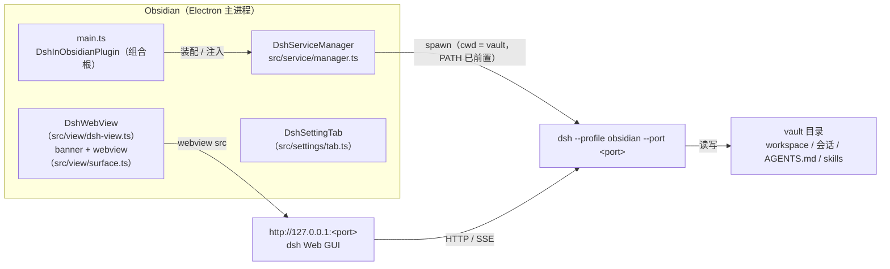

# 架构

## 全景



一句话：**插件 = 服务托管 + 视口**；真正的对话逻辑全在 dsh 服务里，插件不参与数据流。

## 关注点分离

| 关注点 | 归属 | 位置 |
|---|---|---|
| 拉起 / 健康检查 / 重启 / 清理 dsh 进程 | 插件 | `src/service/manager.ts` 的 `DshServiceManager` |
| 可执行文件解析、版本选择、版本探测与 PATH 注入 | 插件 | `src/service/locator.ts`（`resolveDshInstall` + `listDshCandidates`） |
| dsh 版本选择（自动 / 指定检测到的安装） | 插件设置 | `src/settings/schema.ts`（`dshPath`）+ `tab.ts` + `locator.ts` |
| dsh 版本冲突的可见提示（M2-5） | 插件 | `src/service/manager.ts`（日志/回调）+ `src/main.ts`（Notice）+ `src/settings/tab.ts`（运行环境） |
| 0.2.x token 就绪信号与承载面地址 | 插件 | `src/service/manager.ts`（stdout URL 行 → `embedUrl`）+ `src/view/dsh-view.ts` |
| 就绪探测（四态判定 + Obsidian 实现注入） | 插件 | `src/shared/host.ts`（requestUrl 版）；service 只消费注入的探测 |
| 面板承载（banner + webview） | 插件 | `src/view/dsh-view.ts`（注册类型 `dsh-web`）+ `src/view/surface.ts` |
| 页面桥（新建会话 / 单栏 / vault 工作区） | 插件 + dsh 客户端插件 | `src/view/bridge.ts` + `src/main.ts`；dsh 侧 `dsh-obsidian-bridge` |
| 原生聊天 Phase 0（会话列表 / 快照 / 动作 / 审批提问） | 插件 + dsh 客户端插件 v2 | `src/view/native/`；dsh 侧 `packages/dsh-obsidian-bridge/lib/client.js` |
| 打开 / 聚焦面板 | 插件 | `src/view/open.ts` |
| 端口 / profile / 自动启动 | 插件设置 | `src/settings/schema.ts` + `src/settings/tab.ts` |
| 装配与注册（组合根） | 插件 | `src/main.ts` |
| 会话、模型、工具、GUI 渲染 | dsh 服务 | `$DSH_HOME/profiles/obsidian` |
| 项目上下文发现（AGENTS.md、skills） | dsh 服务 | cwd = vault |

## src 分层

按「职责域」分层，依赖方向单向，禁止反向 import（详见 [AGENTS.md](../AGENTS.md) 与 `skills/project-guide` 技能）：

```
src/
├─ main.ts            # 组合根：Plugin 子类，只做注册与装配（注入依赖、映射结果到 Notice）
├─ service/           # dsh 进程域（纯 Node，不 import obsidian）
│  ├─ manager.ts      #   DshServiceManager：探测 → 拉起 → 等待就绪 → 重启 / 停止
│  └─ locator.ts      #   可执行文件解析 + 版本探测 + PATH 注入
├─ view/              # 面板域（可 import obsidian）
│  ├─ dsh-view.ts     #   DshWebView + DshPanelHost 接口
│  ├─ surface.ts      #   承载面（Electron webview，M2-1 / M3 落点）
│  ├─ bridge.ts       #   页面桥：executeJavaScript 调用 / 等待就绪 / 错误归因
│  ├─ native/         #   原生聊天：隐藏 core webview + 数据桥 + React UI（Phase 1）
│  └─ open.ts         #   打开 / 聚焦面板
├─ settings/          # 配置域
│  ├─ schema.ts       #   DshPluginSettings + DEFAULT_SETTINGS + 派生 URL / 校验
│  └─ tab.ts          #   DshSettingTab（+ SettingsHost 接口）
└─ shared/            # 跨域基础件
   ├─ constants.ts    #   视图类型常量 + isDshPage()
   ├─ types.ts        #   Probe / ProbeResult 四态契约
   ├─ async.ts        #   sleep
   ├─ log.ts          #   [obsidian-dsh] / [dsh] 日志约定 + token 打码
   └─ host.ts         #   vault 绝对路径
```

`````
main.ts ──► service/ · view/ · settings/ · shared/
view/   ──► service 接口 · settings/schema · shared/
service/ ─► shared/（async / log，纯 Node）
settings/ ─► shared/
shared/ ──► 无内部依赖
`````

三条硬约束：

1. **`service/` 不 import `obsidian`**：状态文案走构造时注入的 `onStatus` 回调，UI 归 `view/`。这样进程域可单独打包做冒烟测试。
2. **`view/` 不 import `main.ts`**：只依赖窄接口 `DshPanelHost`（由插件实现），避免循环依赖。
3. **不建 `index.ts` barrel**：插件是单产物打包，barrel 只会增加循环依赖风险；直接 import 具体文件。

## 服务生命周期

状态：未知 → 探测中 → 启动中 → 运行中 / 启动失败 / 启动超时 / 端口被占用 / 需手动结束 / 版本不支持，状态条（`DSH: …`）实时反映。

1. **触发**：`onload`（`autoStart` 为真时）、打开面板、命令「重启 DSH 服务」。
2. **去重**：`DshServiceManager.start()` 用内部的 `starting` 字段复用同一个 Promise，避免并发 spawn 多个进程。
3. **探测**：四态判定（`running` / `auth` / `foreign` / `down`）。插件注入基于 Obsidian `requestUrl` 的探测（能读状态码与正文，用 `__ModuleLoader__` 标记确认是 dsh；0.2.x 裸 URL 的 401 正文含 `dsh web authentication required` 时判为 `auth`）。`auth` 表示「端口上是 dsh，但需要浏览器 token」，非本次拉起的实例无法接管，状态条显示「需手动结束」；`running` 表示能直接 200 打开（0.1.x 或未启用鉴权），本插件判为「版本不支持」。
4. **拉起**：`manager` 用 `child_process.spawn`，`cwd` = vault 绝对路径，参数固定为 `--profile <profile> --port <port> --no-open`（`--no-open` 避免 dsh 额外打开系统浏览器）。使用哪份 dsh 由 `resolveDshInstall(settings.dshPath)` 决定：`null` = 自动按解析顺序，指定路径则精确匹配（未命中回退自动并提示）。stdout/stderr **按整行缓冲**后转发到开发者控制台（前缀 `[dsh]`，整行做 `token=` 打码，避免 token 被 chunk 拆开时漏打）。
5. **等待就绪**：最多 40 × 500ms（约 20s），同时 race 子进程 `exit` —— 进程提前退出会立刻报「启动失败(退出码 N)」，不干等 20s。就绪只认 0.2.x 的 stdout 整行 `dsh web: <url>`（同时保存带 token 的承载面地址）；行可能被拆成多个 chunk，必须等整行到齐再匹配，否则会丢 token。spawn 前的探测用于区分端口占用与遗留实例：`foreign` 报「端口被占用」，`auth` 报「需手动结束」，`running` 报「版本不支持」；spawn 后不再轮询探测，端口真被占用时由子进程 `EADDRINUSE` 退出收敛。超时会先杀掉自己刚拉起的子进程，避免留下孤儿。
6. **承载面地址**：`manager.embedUrl` 是带 token 的 URL（浏览器首次登录后走 cookie）；未就绪时回退不带 token 的 `url`。banner/设置页/日志只用 `url`，token 不进展示文本。
7. **卸载**：`onunload` 只杀**自己 spawn 的**子进程（`SIGTERM`，2s 后兜底 `SIGKILL`），用户手动启动的实例不动。
8. **重启**：`manager.restart()` → `stopAndWait(3000)`（等 `exit`，超时 `SIGKILL` 再等 1s）→ 重新 `start()`，避免 `EADDRINUSE` 与「误判已就绪」。切换 dsh 版本后需手动点「重启服务」；重启后 token 变化，已打开的面板建议重开。

## 进程解析与环境

插件启动子进程时**不能假设 PATH 可用**（Obsidian 从 Finder/Dock 启动时是精简环境）：

- **可执行文件解析顺序**（`resolveDshCommand()`）：
  1. `node` + `~/.local/lib/node_modules/@deepseek-ai/dsh/lib/bin.js`（绕开 `#!/usr/bin/env node` shebang 解析）；
  2. `PATH` 上的 `dsh`；
  3. `~/.local/bin/dsh`、`/opt/homebrew/bin/dsh`、`/usr/local/bin/dsh`。
- **环境注入**（`buildSpawnEnv()`）：把 `~/.local/bin`、`/opt/homebrew/bin`、`/usr/local/bin` 前置到 `PATH`（存在才加）。
- 常见坑：两条路径都要保持可用。本机 `~/.local/bin/dsh` 是指向开发 checkout（`~/dsh/deepseek-harness/apps/cli/lib/bin.js`）的符号链接；只要 `~/.local/lib/node_modules/@deepseek-ai/dsh/lib/bin.js` 存在，第 1 条就会命中并**优先使用那份全局安装**（本机可能是 0.1.x，旧于 checkout 的 0.2.x）—— 版本不一致时以实际运行的为准，别假设用的是 checkout（见 [troubleshooting](troubleshooting.md)）。
- 版本可见性（M2-5）：`listDshCandidates()` 按上面的顺序列出所有可用安装（按 `realpath` 去重），`probeDshVersion()` 执行 `<cmd> --version`（3s 超时，失败返回 `null`），`inspectDshRuntime()` 返回「实际使用 + 版本不同的其他安装」。manager 在 spawn 成功后**后台**探测（不 await，不拖慢启动），写 `[obsidian-dsh] dsh 版本: …`；服务已在运行（非本次拉起）时同样探测，但结果标为 `confirmed: false`，日志写「插件将使用 …」。有冲突时再写一条 `console.warn` 日志，并通过 `onRuntime` 回调交给插件层：插件加载/重启后弹一次 Notice（确认时用「当前使用」，未确认时用「插件将使用」），设置页「运行环境」常驻显示路径/版本/其他安装。
- 版本选择（0003）：设置页「dsh 版本」下拉只列 `listDshCandidates()` 检测到的安装（自动 / 指定路径，显示版本号），存 `settings.dshPath`；`resolveDshInstall(preferredPath)` 按展示路径 / 启动命令 / `realpath` 匹配，未命中回退自动并通过 `fallback` 提示。显式选择后不再弹版本冲突 Notice；自动模式才提示。修改后需手动「重启服务」。
- token 处理（0003）：0.2.x 的就绪 URL 从 stdout 整行解析，保存在 `manager.embedUrl`（承载面用）；stdout/stderr 按整行缓冲后再交给 `logChild`，整行做 `token=` 打码（跨 chunk 也不会漏），就绪日志同样打码。token 是每进程新生成的，**非本次拉起的 0.2.x 实例无法接管**。

## 视图与承载面

- 视图类型常量 `dsh-web`，在 `onload` 里 `registerView` 注册。
- 打开逻辑：已有 leaf → `revealLeaf` + `setActiveLeaf`；没有 → `getRightLeaf(false)` 新建并 `setViewState` —— 保证**只有一个面板**。
- 面板结构：顶部 banner（URL / 连接状态）+ 撑满的 `<webview>`；样式走 [styles.css](../styles.css) 的 Obsidian 主题变量。
- 为什么用 webview（0004）：dsh 0.2.x 的会话 cookie 是 `SameSite=Strict`，iframe 在 `app://obsidian.md` 顶层里属于跨站，
  303 之后不会带 cookie，必然 401；`<webview>` 的 guest 是独立顶层浏览上下文，并与核心 Web viewer / Canvas 网页卡片
  共用 `persist:vault-<appId>` 分区，cookie 正常。它仍是跨源宿主，**无法访问内部 DOM**，数据互通只能靠 `postMessage`（见 roadmap M3）。
- 能力探测：`surface.ts` 先查 `customElements.get('webview')`，可用才创建（`partition` / `src` 在挂载前设置）；
  不可用时返回 `null`，view 显示错误并提示升级 Obsidian，**不再回退 iframe**（0007）。
- 承载面自愈：服务就绪且尚未成功加载过时，`DshSurface.reload()` 用 `loadURL` 重新导航一次（已连接后不再重载，避免打断用户操作）。
- 页面桥（2026-10-26）：webview 还能执行脚本（`DshSurface.executeJavaScript` → `DshWebView.runScript`）。
  dsh 侧 `dsh-obsidian-bridge`（本仓库 `packages/`）在页面里挂 `window.__DSH_OBSIDIAN_BRIDGE__`；Obsidian 侧
  `src/view/bridge.ts` 负责调用、等待就绪与错误归因。当前用途：新建会话（固定 vault 工作区）与单栏常开。
- 原生聊天（0006，Phase 1）：`src/view/native/native-chat-view.tsx` 固定在右侧栏开一个视图，内部放
  **隐藏的官方 DSH webview**（`left:-10000px`，不 `display:none`），再用 `core-bridge.ts` 调用 bridge v2：
  会话列表、`subscribe`、`snapshot`、`nextEvent` 长轮询、发送/停止/加载更早、审批/提问、模型目录与权限投影。
  `ui/` 是 React 18 UI：标题/会话浮层、消息与工具卡、当前笔记条、输入框、模型/权限浮层；`note-tracker.ts`
  记住最后一次激活的 Markdown 笔记。原生视图只允许右栏一个实例；与官方 webview 面板同时开着仍会各连
  一个 DSH 客户端，不默认双开。
- 原生聊天不重写 DSH core：ChatSnapshot / 会话动作 / 待处理交互都来自官方页面；模型选择只选已配置
  provider/model，provider 与 API key 配置仍在 DSH 设置页。
- 模型/权限来源（0.2.1-rc.3 实测）：模型目录优先走 `ctx.modelDirectories.directoryFor(sessionId)`
  （`load/select/store`，与官方模型菜单同一份状态），`connection.api.sessions` 只作回退；
  权限读 `session.projections.faceOf("permissions")`，宿主只推 `currentValue` 时用内置三预设兜底。
- 浮层不用 Obsidian `Menu`：右栏视图里 `menu.showAtPosition()` 的 `dom` 不会挂到 document
  （`isConnected === false`），所以模型/权限/`⋯` 都是 React 自绘浮层 + 背景遮罩。

## 配置与持久化

| 配置 | 默认值 | 存放位置 | 说明 |
|---|---|---|---|
| `port` | 3081 | 插件目录 `data.json` | 改完需「重启服务」 |
| `profile` | obsidian | 同上 | 必须已存在于 `$DSH_HOME/profiles/` |
| `autoStart` | true | 同上 | Obsidian 启动时自动拉起 |
| `dshPath` | null | 同上 | null = 自动按解析顺序；也可指定检测到的某份 dsh（改完需「重启服务」） |

- **默认值**写在 `DEFAULT_SETTINGS`；用户值由 Obsidian 持久化到插件目录的 `data.json`。开发期用符号链接安装，所以 `data.json` 落在本仓库根目录 —— 它是**运行时数据**，不要当源码改。
- 面板地址由 `settings/schema.ts` 的 `serviceUrl(port)` 派生（唯一的推导入口）；改端口后 banner 立即变化，但已打开的承载面需要重开面板才会重新加载（roadmap M2-1）。

## dsh 侧约定（profile 与客户端插件）

- profile：`$DSH_HOME/profiles/obsidian/`，`package.json` 的 `dsh.profile.bundles` 基础为
  `["@deepseek-ai/dsh-base", "@deepseek-ai/dsh-web-app"]`，`dsh plugin add` 会自动并入 `dsh-obsidian-bridge`。
- `cordis.yml` 是空入口列表，**要改的是 `cordis.patch.yml`**（用户层）；其余插件由各自 bundle 的 patch 插入，避免手动挂行造成双实例。
- cwd = vault 带来的行为：dsh 的 workspace、会话分组、`AGENTS.md`、`skills/` 发现都落在笔记库上 —— 这是本方案的核心收益。
`dsh-obsidian-bridge` 已迁入本仓库 `packages/dsh-obsidian-bridge/`（0007）；
  `dsh-obsidian-mentions`、`dsh-ui-obsidian-layout` 仍在外部仓库维护，细节见根 README。
  当前 obsidian profile 实际安装的是 **`dsh-obsidian-bridge`**：单栏（CSS 零化左右轨道 + 收起 store）、
  `newSession()`（`ctx.uiWorkspace.startSession(vaultWorkspaceId)`）与 vault 工作区解析。
  它依赖 dsh 0.2.x 的 `ctx.uiWorkspace` / `ctx.workspaces` / `ctx.layout` / `ctx.sidebarRight`；
  0006 的 native core API 也会加在同一个插件的 v2 上。

## 已知设计债

M2、M2 后续（0003）、webview 承载（0004）、Obsidian 入口（0005）与 0.2.x-only 清理（0007）代码已完成：M2-1 ~ M2-6 见 [proposal 0001](changes/0001-m2-stability-fixes.md)，M2-5 见 [0002](changes/0002-m2-locator-version-visibility.md)，dsh 版本选择 + token 见 [0003](changes/0003-dsh-version-selection-and-token-auth.md)，webview 承载见 [0004](changes/0004-webview-embedding.md)，ribbon/命令新建会话 + 单栏 + dsh 桥见 [0005](changes/0005-obsidian-native-surfaces.md)，0.1.1 / iframe 兼容移除与插件迁入见 [0007](changes/0007-drop-legacy-and-migrate-bridge.md)。
剩余人工确认：Obsidian 内 0.2.x webview 面板加载、版本切换；0005 的单栏实际效果、跨栏收回、新建会话落点与未装桥降级；0007 的新 link 路径。之后是 M4 原生聊天（0006）与 M5（工程化）。
