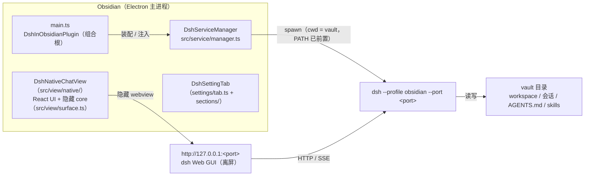

# 架构

## 全景



一句话：**插件 = 服务托管 + 原生聊天 UI + 隐藏 core**；对话逻辑仍在 dsh 服务里，插件只负责渲染与转发 JSON。

## 关注点分离

| 关注点 | 归属 | 位置 |
|---|---|---|
| 拉起 / 健康检查 / 重启 / 清理 dsh 进程 | 插件 | `src/service/manager.ts` 的 `DshServiceManager` |
| 可执行文件解析、版本选择、版本探测与 PATH 注入 | 插件 | `src/service/locator.ts`（`resolveDshInstall` + `listDshCandidates`） |
| dsh 版本选择（自动 / 指定检测到的安装） | 插件设置 | `src/settings/schema.ts`（`dshPath`）+ `src/settings/sections/runtime.ts` + `locator.ts` |
| dsh 版本冲突的可见提示（M2-5） | 插件 | `src/service/manager.ts`（日志/回调）+ `src/main.ts`（Notice）+ `src/settings/sections/runtime.ts`（运行环境） |
| 0.2.x token 就绪信号与承载面地址 | 插件 | `src/service/manager.ts`（stdout URL 行 → `embedUrl`）+ `src/view/native/native-chat-view.tsx` |
| 就绪探测（四态判定 + Obsidian 实现注入） | 插件 | `src/shared/host.ts`（requestUrl 版）；service 只消费注入的探测 |
| 原生聊天视图（React UI） | 插件 | `src/view/native/native-chat-view.tsx` + `ui/` |
| 隐藏 core 承载（Electron webview + 专用分区） | 插件 | `src/view/surface.ts`；分区由 `src/main.ts` 提供 |
| 页面桥 v8（会话 / 快照 / 动作 / 审批提问 / 模型权限 / 流式 live / 上下文占用 / 命令与技能目录 / 团队投影 / 子智能体目录与子会话 / 目标投影与目标操作） | 插件 + dsh 客户端插件 | `src/view/native/core-bridge.ts` + `src/main.ts`；dsh 侧 `packages/dsh-obsidian-bridge/lib/client.js` |
| 流式输出（live tail） | 插件 + dsh 客户端插件 | 桥同步订阅 `SessionBinding.eventSource`，`nextEvent` 同时返回结构游标与 `liveCursor/live`；原生端在 `timeline-model.ts` 合成运行中的 assistant-step |
| 宿主接口（地址 / 分区 / 服务生命周期 / 设置读取） | 插件 | `src/view/panel-host.ts` |
| 「@」引用范围（白名单 / 黑名单，0030） | 插件设置 | `src/settings/schema.ts` + `src/settings/sections/chat.ts` + `src/view/native/mention-scope.ts`（纯函数过滤）+ `src/view/panel-host.ts` / `src/main.ts`（`getMentionScope`）+ `src/view/native/ui/native-chat-root.tsx` |
| 「/」菜单技能范围（白名单 / 黑名单，0037） | 插件设置 | `src/settings/schema.ts`（`ScopeMode` + `skillScope` / `skillWhitelist` / `skillBlacklist`）+ `src/settings/sections/chat.ts` + `src/view/native/skill-scope.ts`（纯函数过滤）+ `src/view/panel-host.ts` / `src/main.ts`（`getSkillScope`）+ `src/view/native/ui/native-chat-root.tsx` / `composer.tsx` |
| 「/」菜单命令透传 + 命令范围（0050） | 插件设置 | `src/settings/schema.ts`（`commandScope` / `commandWhitelist` / `commandBlacklist` + 命令名归一化）+ `src/settings/sections/chat.ts`（命令范围卡片）+ `src/view/native/command-scope.ts`（纯函数：范围过滤 / 隐藏 /export / 同名技能隐藏 / leading 命令识别）+ `src/view/native/slash.ts`（`commands()` → 菜单行 + 中文标签）+ `composer.tsx`（命令目录 / Enter 路由）+ `native-chat-root.tsx`（`runCommand`）+ `panel-host.ts` / `main.ts`（`getCommandScope`） |
| 白 / 黑名单添加栏的「选取」（0038） | 插件设置 | `src/settings/sections/chat.ts`（分组卡片 + 行首按钮 + `SuggestModal`）+ `src/settings/scope-candidates.ts`（候选构造：排除已有 / 被覆盖 / 隐藏）+ `src/service/skill-catalog.ts`（扫描本地技能目录取技能名）+ `src/settings/context.ts` / `src/main.ts`（`getSkillCandidates`） |
| 命令范围的「选取」（0051） | 插件设置 + 面板桥 | `src/settings/context.ts` / `src/main.ts`（`getCommandCandidates` → `findNativeChat`）+ `src/view/native/native-chat-view.tsx`（`listCommandNames()` → 桥 `commands()`，过滤 `/export`）+ `src/settings/scope-candidates.ts`（`listCommandCandidates`）+ `src/settings/sections/chat.ts`（命令卡片 `pickKind: 'command'`）；面板未打开时返回空数组，手动输入兜底 |
| dsh 插件清单与组件行启停（设置页「插件」tab，0031） | 插件设置 + 插件 | `src/service/plugin-inventory.ts`（`dsh --dump-config` 解析 + 版本 + 缓存）+ `src/service/plugin-patch.ts`（写 profile 用户层 `cordis.patch.yml`：备份 / 原子写 / 复验回滚）+ `src/settings/sections/plugins.ts` + `src/settings/context.ts` / `src/main.ts` |
| 可选 / 实验性插件（启用 / 停用 bundle，0032） | 插件设置 + 插件 | `src/service/plugin-catalog.ts`（读 `@deepseek-ai/dsh-official-bundles` 目录 + 版本 / 中文标题）+ `src/service/plugin-bundles.ts`（写 profile `package.json` 的 `dsh.profile.bundles`：备份 / 原子写 / 复验回滚）+ `src/settings/sections/plugins.ts` + `src/main.ts`（白名单校验） |
| Agent Teams 只读团队面板（0035） | 插件 + dsh 客户端插件 | `src/view/native/ui/team-panel.tsx` + `src/view/native/ui/native-chat-root.tsx`（标题右侧入口）+ `src/shared/native-types.ts`；桥 `team()` 读 Lead 的 `agentTeam` 投影并拼运行状态 / 模型 |
| 子智能体目录与子会话导航（0041） | 插件 + dsh 客户端插件 | `src/view/native/ui/subagent-panel.tsx` + `native-chat-root.tsx`（入口 / 面包屑 / 只读判定）+ `src/shared/native-types.ts`；桥 `subagents()` 读父会话 `subagentCatalog` 投影并拼子会话状态 / 耗时 / token / 模型，`subscribe(address)` 打开子会话 |
| 旧 `dsh-web` leaf 迁移 | 插件 | `src/main.ts` 的 `migrateLegacyPanel` |
| 打开 / 聚焦面板 | 插件 | `src/view/open.ts` |
| 端口 / profile / 自动启动 | 插件设置 | `src/settings/schema.ts` + `src/settings/sections/service.ts` |
| 设置页模块拆分（顶部 tab） | 插件设置 | `src/settings/tab.ts`（tab 条 + 调度）+ `src/settings/sections/` |
| 装配与注册（组合根） | 插件 | `src/main.ts` |
| 会话、模型、工具 | dsh 服务 | `$DSH_HOME/profiles/obsidian` |
| 项目上下文发现（AGENTS.md、skills） | dsh 服务 | cwd = vault |

## src 分层

按「职责域」分层，依赖方向单向，禁止反向 import（详见 [AGENTS.md](../AGENTS.md) 与 `skills/project-guide` 技能）：

```
src/
├─ main.ts            # 组合根：Plugin 子类，只做注册与装配（注入依赖、映射结果到 Notice）
├─ service/           # dsh 进程域（纯 Node，不 import obsidian）
│  ├─ manager.ts      #   DshServiceManager：探测 → 拉起 → 等待就绪 → 重启 / 停止
│  ├─ locator.ts      #   可执行文件解析 + 版本探测 + PATH 注入
│  ├─ plugin-inventory.ts # 插件清单：--dump-config 组合结果解析 + 版本（0031）
│  ├─ plugin-patch.ts #   组件行启停：cordis.patch.yml 最小覆盖（备份 / 原子写 / 回滚，0031）
│  ├─ plugin-catalog.ts # 可选 / 实验性插件目录：official-bundles 名单 + 元信息（0032）
│  └─ plugin-bundles.ts # bundle 启停：profile package.json 的 dsh.profile.bundles（0032）
├─ view/              # 面板域（可 import obsidian）
│  ├─ panel-host.ts   #   原生视图需要的最小宿主接口（DshPanelHost）
│  ├─ surface.ts      #   隐藏 core 的 Electron webview 承载
│  ├─ native/         #   原生聊天：React UI + 隐藏 core + 数据桥
│  │  ├─ native-chat-view.tsx # ItemView：装配 React、隐藏 core、probe
│  │  ├─ core-bridge.ts       # executeJavaScript 调用 / 等待就绪 / 错误归因
│  │  ├─ note-tracker.ts      # 最后一次激活的 Markdown 笔记
│  │  └─ ui/                  # 浮层骨架（menu-shell）+ 模型/权限/会话菜单 + 时间线与节点渲染
│  └─ open.ts         #   打开 / 聚焦原生面板
├─ settings/          # 配置域
│  ├─ schema.ts       #   DshPluginSettings + DEFAULT_SETTINGS + 端口校验
│  ├─ context.ts      #   SettingsHost + SettingsRenderContext（模块渲染上下文）
│  ├─ tab.ts          #   DshSettingTab：模块 tab 条 + 内容区调度
│  └─ sections/       #   各设置模块：service / runtime / chat / integration / plugins
└─ shared/            # 跨域基础件
   ├─ constants.ts    #   视图类型常量 + isDshPage()
   ├─ types.ts        #   Probe / ProbeResult 四态契约
   ├─ async.ts        #   sleep
   ├─ errors.ts       #   errorText()：unknown → 可读文案
   ├─ log.ts          #   [obsidian-dsh] / [dsh] 日志约定 + token 打码
   └─ host.ts         #   vault 绝对路径
```

`````
main.ts ──► service/ · view/ · settings/ · shared/
view/   ──► service 接口 · settings/schema · shared/
service/ ─► shared/（async / log，纯 Node）
settings/ ─► shared/
shared/ ──► 无内部依赖
`````

三条硬约束：

1. **`service/` 不 import `obsidian`**：状态文案走构造时注入的 `onStatus` 回调，UI 归 `view/`。这样进程域可单独打包做冒烟测试。
2. **`view/` 不 import `main.ts`**：只依赖窄接口 `DshPanelHost`（由插件实现），避免循环依赖。
3. **不建 `index.ts` barrel**：插件是单产物打包，barrel 只会增加循环依赖风险；直接 import 具体文件。

## 服务生命周期

状态：未知 → 探测中 → 启动中 → 运行中 / 启动失败 / 启动超时 / 端口被占用 / 需手动结束 / 版本不支持，状态条（`DSH: …`）实时反映。

1. **触发**：`onload`（`autoStart` 为真时）、打开原生聊天、命令「重启 DSH 服务」。
2. **去重**：`DshServiceManager.start()` 用内部的 `starting` 字段复用同一个 Promise，避免并发 spawn 多个进程。
3. **探测**：四态判定（`running` / `auth` / `foreign` / `down`）。插件注入基于 Obsidian `requestUrl` 的探测（能读状态码与正文，用 `__ModuleLoader__` 标记确认是 dsh；0.2.x 裸 URL 的 401 正文含 `dsh web authentication required` 时判为 `auth`）。`auth` 表示「端口上是 dsh，但需要浏览器 token」，非本次拉起的实例无法接管，状态条显示「需手动结束」；`running` 表示能直接 200 打开（0.1.x 或未启用鉴权），本插件判为「版本不支持」。
4. **拉起**：`manager` 用 `child_process.spawn`，`cwd` = vault 绝对路径，参数固定为 `--profile <profile> --port <port> --no-open`（`--no-open` 避免 dsh 额外打开系统浏览器）。使用哪份 dsh 由 `resolveDshInstall(settings.dshPath)` 决定：`null` = 自动按解析顺序，指定路径则精确匹配（未命中回退自动并提示）。stdout/stderr **按整行缓冲**后转发到开发者控制台（前缀 `[dsh]`，整行做 `token=` 打码，避免 token 被 chunk 拆开时漏打）。
5. **等待就绪**：最多 40 × 500ms（约 20s），同时 race 子进程 `exit` —— 进程提前退出会立刻报「启动失败(退出码 N)」，不干等 20s。就绪只认 0.2.x 的 stdout 整行 `dsh web: <url>`（同时保存带 token 的承载面地址）；行可能被拆成多个 chunk，必须等整行到齐再匹配，否则会丢 token。spawn 前的探测用于区分端口占用与遗留实例：`foreign` 报「端口被占用」，`auth` 报「需手动结束」，`running` 报「版本不支持」；spawn 后不再轮询探测，端口真被占用时由子进程 `EADDRINUSE` 退出收敛。超时会先杀掉自己刚拉起的子进程，避免留下孤儿。
6. **隐藏 core 地址**：`manager.embedUrl` 是带 token 的 URL（首次登录后走专用分区 cookie）；未就绪时回退裸 `url`。原生面板不展示 URL，token 不进 Notice / 设置页 / 日志。
7. **卸载**：`onunload` 只杀**自己 spawn 的**子进程（`SIGTERM`，2s 后兜底 `SIGKILL`），用户手动启动的实例不动。
8. **重启**：`manager.restart()` → `stopAndWait(3000)`（等 `exit`，超时 `SIGKILL` 再等 1s）→ 重新 `start()`，避免 `EADDRINUSE` 与「误判已就绪」。切换 dsh 版本后需手动点「重启服务」；`main.restartService()` 成功后若原生面板开着，会调用 `reloadAfterRestart()` 用新 token 重载隐藏 core，不需要手动重开。

## 进程解析与环境

插件启动子进程时**不能假设 PATH 可用**（Obsidian 从 Finder/Dock 启动时是精简环境）：

- **可执行文件解析顺序**（`resolveDshInstall()`）：
  1. `node` + `~/.local/lib/node_modules/@deepseek-ai/dsh/lib/bin.js`（绕开 `#!/usr/bin/env node` shebang 解析）；
  2. `PATH` 上的 `dsh`；
  3. `~/.local/bin/dsh`、`/opt/homebrew/bin/dsh`、`/usr/local/bin/dsh`。
- **环境注入**（`buildSpawnEnv()`）：把 `~/.local/bin`、`/opt/homebrew/bin`、`/usr/local/bin` 前置到 `PATH`（存在才加）。
- 常见坑：两条路径都要保持可用。本机 `~/.local/bin/dsh` 是指向开发 checkout（`~/dsh/deepseek-harness/apps/cli/lib/bin.js`）的符号链接；只要 `~/.local/lib/node_modules/@deepseek-ai/dsh/lib/bin.js` 存在，第 1 条就会命中并**优先使用那份全局安装**（本机可能是 0.1.x，旧于 checkout 的 0.2.x）—— 版本不一致时以实际运行的为准，别假设用的是 checkout（见 [troubleshooting](troubleshooting.md)）。
- 版本可见性（M2-5）：`listDshCandidates()` 按上面的顺序列出所有可用安装（按 `realpath` 去重），`probeDshVersion()` 执行 `<cmd> --version`（3s 超时，失败返回 `null`），`inspectDshRuntime()` 返回「实际使用 + 版本不同的其他安装」。manager 在 spawn 成功后**后台**探测（不 await，不拖慢启动），写 `[obsidian-dsh] dsh 版本: …`；服务已在运行（非本次拉起）时同样探测，但结果标为 `confirmed: false`，日志写「插件将使用 …」。有冲突时再写一条 `console.warn` 日志，并通过 `onRuntime` 回调交给插件层：插件加载/重启后弹一次 Notice（确认时用「当前使用」，未确认时用「插件将使用」），设置页「运行环境」常驻显示路径/版本/其他安装。
- 版本选择（0003）：设置页「dsh 版本」下拉只列 `listDshCandidates()` 检测到的安装（自动 / 指定路径，显示版本号），存 `settings.dshPath`；`resolveDshInstall(preferredPath)` 按展示路径 / 启动命令 / `realpath` 匹配，未命中回退自动并通过 `fallback` 提示。显式选择后不再弹版本冲突 Notice；自动模式才提示。修改后需手动「重启服务」。
- token 处理（0003）：0.2.x 的就绪 URL 从 stdout 整行解析，保存在 `manager.embedUrl`（承载面用）；stdout/stderr 按整行缓冲后再交给 `logChild`，整行做 `token=` 打码（跨 chunk 也不会漏），就绪日志同样打码。token 是每进程新生成的，**非本次拉起的 0.2.x 实例无法接管**。

## 视图与承载面

- **唯一可见视图**：`dsh-native-chat`（`src/view/native/native-chat-view.tsx`），在 `onload` 里
  `registerView` 注册。可见的 `dsh-web` 面板已删除（0008）。
- 打开逻辑：已有 leaf → `revealLeaf` + `setActiveLeaf`；没有 → `getRightLeaf(false)` 新建并
  `setViewState` —— 保证只有一个原生面板。旧 `dsh-web` leaf 在 `onLayoutReady` 时关闭；
  若此时没有原生视图则打开一个，并在 1.5s 后再去重恢复出来的原生 leaf。
- 面板结构：React UI 占满视图；`containerEl` 里另有一个离屏 `div.dsh-native-core-host`，内含官方
  DSH `<webview>`（`left:-10000px`，不 `display:none`），只用于加载 core 与 bridge。
- **为什么保留隐藏 core（0008）**：原生面板的 ChatSnapshot、发送/停止、加载更早、审批/提问、模型/权限
  都来自官方页面；dsh 0.2.x 没有公开的 headless / stdio 客户端通道。去掉隐藏 core = 在插件里重写
  DSH 客户端核心，不在范围。
- **为什么是 webview 而不是 iframe（0004）**：dsh 0.2.x 的会话 cookie 是 `SameSite=Strict`，iframe 在
  `app://obsidian.md` 顶层里属于跨站，303 之后不会带 cookie，必然 401；`<webview>` 的 guest 是独立
  顶层浏览上下文，cookie 正常。
- **分区**：隐藏 core 使用插件专用 `persist:dsh-obsidian`，不再与核心 Web viewer / Canvas 的
  `persist:vault-<appId>` 共用 cookie；其它 Obsidian webview 不会复用 dsh 登录态。
- 能力探测：`surface.ts` 先查 `customElements.get('webview')`，可用才创建（`partition` / `src` 在挂载前
  设置）；不可用时返回 `null`，view 显示错误并提示升级 Obsidian，**不回退 iframe**（0007）。
- 自愈：`DshNativeChatView.ensureReady()` 合并并发 reload，服务就绪后用带 token 地址重新导航；
  命令重启服务时 `main.restartService()` 调 `reloadAfterRestart()`，不需要手动重开面板。
- 页面桥：`core-bridge.ts` 通过 `executeJavaScript` 调用页面里的 `window.__DSH_OBSIDIAN_BRIDGE__`（v8）：
  会话列表、`subscribe`、`snapshot`、`nextEvent` 长轮询、发送/停止/加载更早、审批/提问、模型目录、
  权限投影、上下文占用（`contextPressure` / `contextBreakdown`）与标题（`title`，0033：标题一变就 bump，
  面板标题与会话列表即时跟随），输入框 “/” 菜单要用的
  宿主命令目录（`commands`）、技能目录（`skills`）与命令行提交（`executeCommand`），
  Agent Teams 团队投影（`team`，0035：读 Lead 的 `agentTeam` 投影，补成员运行状态 / 等待授权 / 模型），
  以及子智能体目录（`subagents()`，0041：父会话 `subagentCatalog` + 子会话 `subagent` / `subagentTiming` /
  `tokenUsage` / `modelSelection` 与 `uiSession.sessionStatus`）。
  桥 v8 增加会话目标（0052）：`goal()` 读会话 `goal` 投影（id / revision / objective / phase /
  blockedReason / maxGoalRounds / roundsStarted），并按需 `remote.goals.get()` 补进程内 `activation`
  （同一 `{ id, revision }` 并发去重，`goal/activation-changed` 事件只跟随当前会话）；`goalAction()` 以
  `{ id, revision }` 为 CAS ref 走 `remote.goals` 的 edit / pause / resume / clear，业务失败以 `{ ok:false, error }` 返回。
  桥 v5 起用 `ctx.inject(['remote', 'remote.commands' | 'remote.skills'])` 取宿主命名空间：
  cordis 会拒绝未注入的 `remote.*`；profile 缺 commands / skills 插件时只让这两项报错，桥照常加载。
  桥 v6 把 `agentTeam` 加进 `subscribe` 的投影订阅键表，团队状态变化直接唤醒 `nextEvent`，面板无需刷新。
  桥 v7 起 `subscribe` 也接受 `{ parentSessionId, childSessionId, mode }`：桥用 `sessions.retain(address)` 拿子会话 ref，
  再用现有快照 / 流式管线（`prompt` / `cancel` 由 dsh 自动路由到 `subagents/prompt` / `subagents/interruptByParent`），
  因此续聊与 Stop 不需要新协议；`snapshot()` 透传 `session.subagent`（地址 + `parentAvailable`）供面包屑与只读判定。
  约束：dsh 的列表快照会把子会话行也放进 `ids`（本机 0.2.1-rc.3 实测，行上带 `origin: 'subagent'` 与 `parentId`），
  所以桥 v7 起在 `listSessions()` 里额外透出 `origin` / `parentId`，原生面板按 `origin !== 'subagent'` 过滤——
  子会话**不进入会话选择器**，只能从子智能体入口打开；目录只列直接子级并过滤 `external`，深层嵌套留后续。
- 流式输出（0017）：桥 v3 同步订阅 `SessionBinding.eventSource`，把 `assistant/live-chunk` 累积成
  `blocks`（正文 / 思考 / 工具参数）；`nextEvent` 同时返回结构 `cursor/changed` 与 `liveCursor/live`。
  原生端在 `timeline-model.ts` 合成一条 `live:<turn>:<step>` 的 assistant-step，settle 后由正式节点接管。
  这样不依赖隐藏 core 的 rAF（离屏时只有 2~3 帧/秒），旧桥缺 `liveStream` 时软降级为整段出现。
- 流式刷新（0021）：桥**每个 chunk 立即** `bumpLive()`（离屏 webview 的 `setTimeout` 会被拖到 ~75ms，
  所以不在桥里合批）；原生端用 `requestAnimationFrame` 合帧，按设置里的最小间隔渲染
  （逐字 0 / 每帧 16ms / 平衡 50ms / 省电 100ms）。流式期间正文走纯文本
  `.dsh-native-live-text`，settle 后一次性 Markdown 排版，避免每帧重排整段 Markdown。
  `native-chat-view.tsx` 把 React 的 `createSession` 注册为 `NativeChatActions`（命令入口用），`probeBridge()`
  供设置页检测。
- `ui/` 是 React 18 UI：标题/会话浮层、消息与工具卡、输入框（@ 引用下拉：当前笔记 + 项目文件；目录行箭头下钻）、模型/权限浮层、只读团队浮层（`team-panel.tsx`）、只读子智能体目录（`subagent-panel.tsx`，入口 / 面包屑在 `native-chat-root.tsx`）；
  `note-tracker.ts` 记住最后一次激活的 Markdown 笔记，`mention.ts` 负责 @ token、候选排序与插入文本（对齐 dsh 的 `@` 补全：Enter 采纳 / Tab 下钻），`folder-reveal.ts` 把消息里的文件夹 chip 点击落到左侧文件列表。原生视图只允许右栏一个实例。
  「@」菜单的检索范围来自设置项 `mentionScope` / `mentionWhitelist` / `mentionBlacklist`：`native-chat-root.tsx` 在打开菜单取 vault 快照时读 `getMentionScope()`（`main.ts` 从 settings 组装）并交给 `mention-scope.ts` 的 `filterMentionEntries()` 裁剪——白名单只留条目内（含子目录）候选并保留祖先文件夹以便下钻，黑名单排除条目内候选；「当前笔记」首行不受范围影响。因为每次打开菜单才读设置，改完设置**下一次打开 @ 菜单**即生效，无需重启。
- 「/」菜单的技能行范围来自设置项 `skillScope` / `skillWhitelist` / `skillBlacklist`（0037）：`composer.tsx` 每次打开 `/` 菜单时读一次 `getSkillScope()`（`main.ts` 从 settings 组装，`panel-host.ts` 暴露），技能目录返回后在渲染前交给 `skill-scope.ts` 的 `filterSlashSkills()` 裁剪——白名单只留命中技能名、空白名单隐藏全部技能行，黑名单排除命中技能名；条目按技能名前缀语义匹配（`office` 覆盖 `office` 与 `office-*`）。过滤只作用于菜单里「技能」分组要显示的行：`bridge.skills()` 的目录、`/name` 插入、技能加载与执行都不受影响；技能行全被挡掉时菜单显示一行说明（本地 `/new` 不受影响）。改完设置**下一次打开 / 菜单**即生效，无需重启。
- 「/」菜单的命令行从 0050 起不再写死：`composer.tsx` 打开菜单 / 会话就绪时调用桥 `commands()` 取当前会话的 dsh 命令目录（按会话 / 预设变化），`slash.ts` 转成菜单行（六个 first-party 命令按 name 映射中文标签，第三方命令回退 dsh 英文描述），预置的 `/export` 因桥直连执行不触发 Web 下载而隐藏；选中命令只把 `/name ` 插入草稿，Enter 时若草稿**开头**是命令目录里的名字，`native-chat-root.tsx` 的 `runCommand` 走 `bridge.executeCommand()`（不是 `send()`），结果由时间线 command / manual-compaction 节点呈现。技能仍走 `send()`（宿主 pre-step 注入正文）；同名技能行隐藏（命令优先）；subagent 子会话按官方行为不显示命令组。
- 命令范围来自设置项 `commandScope` / `commandWhitelist` / `commandBlacklist`（0050）：打开菜单时快照一次，交给 `command-scope.ts` 的 `filterSlashCommands()` 精确匹配裁剪（命令是扁平命名空间，不走 `-` 前缀）；只影响菜单显示，命令目录与执行不变；白名单为空时命令行全部隐藏并显示说明行。命令范围的「选取」（0051）经 `SettingsHost.getCommandCandidates()` → `findNativeChat(app)` → `DshNativeChatView.listCommandNames()` → 桥 `commands()` 取当前会话命令名（过滤 `/export`）；面板未打开 / 未订阅会话时返回空数组，设置页提示手动输入。
- 原生聊天不重写 DSH core：ChatSnapshot / 会话动作 / 待处理交互都来自官方页面；模型选择只选已配置
  provider/model，不提供 provider / API key 表单。
- 模型/权限来源（0.2.1-rc.3 实测）：模型目录优先走 `ctx.modelDirectories.directoryFor(sessionId)`
  （`load/select/store`，与官方模型菜单同一份状态），`connection.api.sessions` 只作回退；
  权限读 `session.projections.faceOf("permissions")`，宿主只推 `currentValue` 时用内置三预设兜底。
- 上下文占用（0022）：桥读 `contextPressure`（`pressureTokens` / `projectedTokens` / `contextWindow`）
  与 `contextBreakdown`（system / tools / messages），订阅这两个 face 让 `nextEvent` 随用量变化唤醒；
  原生输入栏只画 14px 圆环，点击才展开百分比、`~已用 / 窗口` 与构成条；无数据 / 旧桥时是灰色空环。
- 浮层不用 Obsidian `Menu`：右栏视图里 `menu.showAtPosition()` 的 `dom` 不会挂到 document
  （`isConnected === false`），所以模型/权限/`⋯` 都是 React 自绘浮层 + 背景遮罩。
- 配置入口：官方设置页随官方面板删除；模型/凭据改 `$DSH_HOME/profiles/obsidian/cordis.patch.yml`，
  原生 UI 的「配置说明」按钮给出 Notice，改完在设置页点「重启」。

## 配置与持久化

| 配置 | 默认值 | 存放位置 | 说明 |
|---|---|---|---|
| `port` | 3081 | 插件目录 `data.json` | 改完需「重启服务」 |
| `profile` | obsidian | 同上 | 必须已存在于 `$DSH_HOME/profiles/` |
| `autoStart` | true | 同上 | Obsidian 启动时自动拉起 |
| `dshPath` | null | 同上 | null = 自动按解析顺序；也可指定检测到的某份 dsh（改完需「重启服务」） |
| `streamRefresh` | frame | 同上 | 流式刷新节奏：chunk / frame(16ms) / balanced(50ms) / relaxed(100ms)；面板打开期间即时生效 |
| `mentionScope` | off | 同上 | 「@」引用范围：off(不启用) / whitelist(白名单) / blacklist(黑名单)；下一次打开 @ 菜单生效 |
| `mentionWhitelist` | [] | 同上 | 白名单路径（vault 相对路径，文件夹含子目录 / 单个文件）；读取时归一化、去重 |
| `mentionBlacklist` | [] | 同上 | 黑名单路径（同上） |
| `skillScope` | off | 同上 | 「/」菜单技能范围：off(不启用) / whitelist(白名单) / blacklist(黑名单)；下一次打开 / 菜单生效，只过滤技能行、不影响技能加载 |
| `skillWhitelist` | [] | 同上 | 白名单技能名（小写字母 / 数字 / 点 / 下划线 / 连字符）；读取时归一化、去重；`office` 覆盖 `office` 与所有 `office-*` |
| `skillBlacklist` | [] | 同上 | 黑名单技能名（同上） |
| `commandScope` | off | 同上 | 「/」命令范围：off(不启用) / whitelist(白名单) / blacklist(黑名单)；下一次打开 / 菜单生效，只过滤命令行、不影响命令目录与执行 |
| `commandWhitelist` | [] | 同上 | 白名单命令名（dsh 命令名规则 `^[a-z][a-z0-9_-]*$`，精确匹配）；读取时归一化、去重 |
| `commandBlacklist` | [] | 同上 | 黑名单命令名（同上） |

- 白 / 黑名单添加栏的「选取」只读候选、不写配置（0038 / 0051）：@ 取 vault 快照（`app.vault.getAllLoadedFiles()`），/ 的技能取本地技能目录扫描结果（15s 缓存）、命令取原生面板桥的当前会话 `commands()`（面板未打开时为空）；选中只回填输入框，写回仍走原有「添加」与归一化 / 校验。
- **默认值**写在 `DEFAULT_SETTINGS`；用户值由 Obsidian 持久化到插件目录的 `data.json`。开发期用符号链接安装，所以 `data.json` 落在本仓库根目录 —— 它是**运行时数据**，不要当源码改。
- 服务地址由 `service/manager.ts` 内联构造（`http://127.0.0.1:<port>`，探测与启动日志用）；原生面板不展示 URL。改端口后需重启服务，成功时 `main.restartService()` 会重载隐藏 core。

## dsh 侧约定（profile 与客户端插件）

- profile：`$DSH_HOME/profiles/obsidian/`，`package.json` 的 `dsh.profile.bundles` 基础为
  `["@deepseek-ai/dsh-base", "@deepseek-ai/dsh-web-app"]`，`dsh plugin add` 会自动并入 `dsh-obsidian-bridge`。
- `cordis.yml` 是空入口列表，**要改的是 `cordis.patch.yml`**（用户层）；其余插件由各自 bundle 的 patch 插入，避免手动挂行造成双实例。
- cwd = vault 带来的行为：dsh 的 workspace、会话分组、`AGENTS.md`、`skills/` 发现都落在笔记库上 —— 这是本方案的核心收益。
`dsh-obsidian-bridge` 已迁入本仓库 `packages/dsh-obsidian-bridge/`（0007）；
  `dsh-obsidian-mentions`、`dsh-ui-obsidian-layout` 仍在外部仓库维护，细节见根 README。
  当前 obsidian profile 实际安装的是 **`dsh-obsidian-bridge`**（v0.5.0，桥 VERSION=8）：0008 后插件只调用原生数据桥；
  v1 的单栏、`newSession()`、vault 工作区解析已随 0011 从包里删除（不再有调用方）。
  0017 起桥同步订阅 `SessionBinding.eventSource`，把 `assistant/live-chunk` 累积成 live tail，
  由 `nextEvent(cursor, timeoutMs, liveCursor)` 一并返回；这样不依赖官方 UI 的 rAF 发布。
  桥仍依赖 dsh 0.2.x 的 sessions / uiSession / modelDirectories / eventSource 等内部服务；升级 dsh 时需同步验证。

## 已知设计债

M2、M2 后续（0003）、webview 承载（0004）、Obsidian 入口（0005）、原生聊天（0006）、0.2.x-only 清理（0007）
与“只保留原生面板”（0008）代码已完成：M2-1 ~ M2-6 见 [0001](changes/0001-m2-stability-fixes.md)，M2-5 见
[0002](changes/0002-m2-locator-version-visibility.md)，版本选择 + token 见
[0003](changes/0003-dsh-version-selection-and-token-auth.md)，webview 承载见
[0004](changes/0004-webview-embedding.md)，ribbon/命令新建会话 + 单栏 + dsh 桥见
[0005](changes/0005-obsidian-native-surfaces.md)，原生聊天见
[0006](changes/0006-native-chat-panel.md)，0.1.1 / iframe 兼容移除与插件迁入见
[0007](changes/0007-drop-legacy-and-migrate-bridge.md)，原生-only 见
[0008](changes/0008-native-only-surface.md)。
剩余人工确认：0008 的旧 leaf 迁移、专用分区首次登录、命令重启后原生面板恢复；0006 的真 IME 与
附件 / slash / plan-review 等未覆盖能力；M5（工程化）的 CI / 发布。
已知缺口：官方面板删除后，provider / API key 只能改 obsidian profile，插件内没有设置表单。
