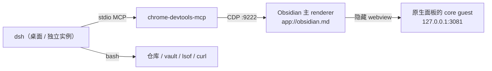

# 用 CDP 让 dsh 操作 / 调试 Obsidian

> 开发期工作流，不是插件的运行时功能。仅桌面端（Obsidian 是 Electron）。
> 适用：dsh 0.2.x + 本仓库 1.0.x；原生面板默认 profile `obsidian` / 端口 3081。
> 0008 后没有可见官方面板；下面说的「面板 guest」是原生视图内部的隐藏 core。

## 为什么是 CDP

dsh 0.2.x 自带 MCP client（`@deepseek-ai/dsh-mcp-client`）。Obsidian 没有官方 MCP，但它的渲染进程就是一个 Chromium 页面；用 Electron 的 `--remote-debugging-port` 把它暴露成 CDP，再接 [chrome-devtools-mcp](https://github.com/ChromeDevTools/chrome-devtools-mcp)，dsh 就能：

- 看 / 改 DOM、CSS、布局；
- 读 console、网络、401 / token 问题；
- 截图；
- 执行任意 `app.*`（vault、workspace、commands、plugins）；
- 重载插件、打开面板、跑原生聊天交互。

它不替代 dsh 自带的编辑 / 构建工具：改代码、`npm run build`、`npm run check` 仍走 bash。



## 0. 前提

- 插件已按 [development.md](development.md#安装到-vault) 用符号链接安装到开发 vault。
- Obsidian 桌面端，dsh 0.2.x。
- **开发 agent 不要跑在面板里**：面板 dsh 是插件子进程，重载插件会把 agent 自己杀掉。用桌面 dsh（不是面板的 3081）或单独起的 dsh。
- 每次开发会话要带调试端口重启 Obsidian；端口只在开发期开。

## 1. 启动 Obsidian（带 CDP）

```bash
# 1) 完全退出；已在运行的话 --args 会被忽略
osascript -e 'quit app "Obsidian"'

# 2) 带端口启动
open -a Obsidian --args --remote-debugging-port=9222

# 3) 验证
curl -s http://127.0.0.1:9222/json/version
curl -s http://127.0.0.1:9222/json/list | python3 -m json.tool | head -60
```

`/json/list` 里应至少能看到：

- `type: "page"`、`url: "app://obsidian.md/..."`：Obsidian 主窗口，`window.app` 在这里；
- 打开原生聊天后，另一个 `http://127.0.0.1:3081/...` 的 target：隐藏 core webview（DSH GUI 本身）。

可选：把启动封装成 shell 函数：

```bash
obs-dev() {
  osascript -e 'quit app "Obsidian"' 2>/dev/null || true
  for _ in {1..10}; do pgrep -x Obsidian >/dev/null || break; sleep 0.5; done
  open -a Obsidian --args --remote-debugging-port=9222
  for _ in {1..40}; do
    curl -sf http://127.0.0.1:9222/json/version >/dev/null && { echo "CDP ready"; return 0; }
    sleep 0.25
  done
  echo "CDP 未就绪：确认 Obsidian 已完全退出、参数生效" >&2
  return 1
}
```

如果 `open --args` 在你的 Obsidian 版本上不生效，直接跑二进制（会占住终端）：

```bash
/Applications/Obsidian.app/Contents/MacOS/Obsidian --remote-debugging-port=9222
```

## 2. 给 dsh 配置 MCP

### 2.1 选 profile

| 跑 dsh 的地方 | 配置文件 | 说明 |
|---|---|---|
| 桌面 dsh（推荐） | `~/.dsh/profiles/desktop/cordis.patch.yml` | 不在插件进程里，重载插件不会杀 agent |
| 面板 dsh | `~/.dsh/profiles/obsidian/cordis.patch.yml` | 会自杀，见 §6.1 |
| 所有 profile | `~/.dsh/cordis.patch.yml` | 方便，但受限 profile 也会多出这些工具 |

> profile 以实际启动参数为准；本仓库插件固定用 `--profile obsidian`。

### 2.2 追加条目

```yaml
- insert:
    - id: mcp-chrome-devtools
      name: '@deepseek-ai/dsh-mcp-client'
      config:
        serverName: devtools
        transport: stdio
        command: npx
        args:
          - '-y'
          - 'chrome-devtools-mcp@1.12.0'
          - '--browser-url'
          - 'http://127.0.0.1:9222'
          - '--no-usage-statistics'
          # 让 list_pages 能看到 Obsidian 的 webview guest
          - '--experimentalIncludeAllPages'
          # 只保留 input / navigation / debugging / network，减少工具 schema
          - '--categoryPerformance=false'
          - '--categoryEmulation=false'
          - '--categoryMemory=false'
        toolCallTimeoutMs: 120000
```

说明：

- `npx` 必须在 dsh 进程的 PATH 上；插件启动 dsh 时会前置 `/opt/homebrew/bin`、`~/.local/bin`、`/usr/local/bin`。不确定就写绝对路径（`which npx`）。
- `--experimentalIncludeAllPages` 让 `list_pages` 能看到 webview guest；不加时默认只列普通 page，面板里的 DSH GUI 会消失。
- `--categoryPerformance/Emulation/Memory=false` 裁掉用不到的工具，减少每次请求的 schema 开销。
- 示例 pin 到 `1.12.0`（验证过上面这些参数）；升级前先跑一次 `--help` 确认参数还在。
- 首次 `npx` 会下载，可能超过 MCP 初始化默认的 60s。先手动预热一次：
  ```bash
  npx -y chrome-devtools-mcp@1.12.0 --help
  ```
- 顺序：**先启动带 9222 的 Obsidian，再重启 dsh**。Obsidian 没起来时 MCP 初始化会失败并按退避重连。

### 2.3 生效与验证

改完 profile 后：

- 桌面 dsh：退出并重开桌面端（会话会保留），或重启对应 host；
- 面板 dsh：命令「重启 DSH 服务」。

新建会话后，工具列表应出现：

```text
mcp__devtools__list_pages
mcp__devtools__take_snapshot
mcp__devtools__evaluate_script
mcp__devtools__list_console_messages
mcp__devtools__get_css_styles
mcp__devtools__take_screenshot
...
```

先调一次 `list_pages` 确认连接。

## 3. 选页面（pageId）

所有 CDP 工具都要 `pageId`（`list_pages` 除外）。

1. `mcp__devtools__list_pages`
2. 认准：
   - `app://obsidian.md/...` → Obsidian 主窗口；
   - `http://127.0.0.1:3081/...` → 原生视图里的隐藏 core（guest）。
3. 后续调用把 `pageId` 传进去；`select_page` 只是切换“当前页”，显式传 `pageId` 更稳。
4. **导航 / 重载 / 重开面板后 pageId 可能变化**，重新 `list_pages`。

## 4. 常用操作

> 以下 `function` 都是传给 `mcp__devtools__evaluate_script` 的 `function` 字段；`pageId` 指向主窗口（除非注明 guest）。
> `app.*` 是 Obsidian 的内部 API（不是公开插件 API），开发期可用，升级后可能变。

### 4.1 一次看全原生面板 / 服务状态

```js
async () => {
  const app = window.app;
  const plugin = app.plugins.plugins['dsh-native-chat'];
  const leaves = app.workspace.getLeavesOfType('dsh-native-chat');
  const view = leaves[0]?.view;
  return {
    pluginLoaded: !!plugin,
    running: plugin ? await plugin.isRunning() : null,
    embedUrl: (plugin?.embedUrl ?? '').replace(/token=[^&]+/, 'token=***'),
    leaves: leaves.length,
    bridge: view?.probeBridge ? await view.probeBridge() : null,
    statusBar: document.querySelector('.dsh-status')?.textContent ?? null,
    nativeRoot: !!document.querySelector('.dsh-native-app'),
    webviewSrc: document.querySelector('.dsh-surface-webview')
      ?.getAttribute('src')
      ?.replace(/token=[^&]+/, 'token=***') ?? null,
  };
}
```

期望（服务就绪 + 原生面板已开）：`pluginLoaded: true`、`running: true`、`leaves: 1`、
`bridge.state: "connected"`、`statusBar: "DSH: 运行中"`、`webviewSrc` 含 `token=***`。
0008 后没有可见官方面板，`.dsh-web-banner` 不再存在。

Obsidian 的 Notice 通常在 `.notice-container` 里，需要断言提示时直接读文本。

### 4.2 重载插件

```js
async () => {
  const app = window.app;
  await app.plugins.disablePlugin('dsh-native-chat');
  await app.plugins.enablePlugin('dsh-native-chat');
  return 'reloaded';
}
```

面板的隐藏 dsh 会被 `onunload` 杀掉；外部 agent 不受影响。若只能用面板 dsh：

```js
() => {
  const app = window.app;
  setTimeout(async () => {
    await app.plugins.disablePlugin('dsh-native-chat');
    await app.plugins.enablePlugin('dsh-native-chat');
  }, 300);
  return 'scheduled';
}
```

### 4.3 执行命令

```js
() => window.app.commands.executeCommandById('dsh-native-chat:open-dsh-view')
```

0008 后只有一个聊天入口（`open-dsh-view` 打开原生面板）；0010 后功能区与命令面板各只剩一个打开入口，可用命令：

- `dsh-native-chat:open-dsh-view`
- `dsh-native-chat:restart-dsh-service`（同 4.2 的自杀风险）

新建会话只在面板内（右上 ＋ / 空态按钮 / 会话选择器），没有对应命令。

列一下：

```js
() => window.app.commands.listCommands()
  .filter(c => c.id.startsWith('dsh-native-chat:'))
  .map(c => ({ id: c.id, name: c.name }))
```

### 4.4 设置

```js
() => ({ ...window.app.plugins.plugins['dsh-native-chat'].settings })
```

改端口（改完要重启服务）：

```js
async () => {
  const p = window.app.plugins.plugins['dsh-native-chat'];
  p.settings.port = 3082;
  await p.saveSettings();
  return p.settings.port;
}
```

### 4.5 DOM / CSS

检查原生面板（可见层）；隐藏 core 的 DOM 在另一个 guest target 里。

```js
() => {
  const el = document.querySelector('.dsh-native-header');
  const cs = getComputedStyle(el);
  return {
    text: el.textContent,
    color: cs.color,
    fontSize: cs.fontSize,
    display: cs.display,
    rect: el.getBoundingClientRect().toJSON(),
  };
}
```

要看层叠规则：先 `take_snapshot` 拿元素的 `uid`，再 `get_css_styles`（`pageId` + `uid`）。

### 4.6 console / network

```text
mcp__devtools__list_console_messages  { pageId, includeStackTraces: true }
mcp__devtools__list_network_requests  { pageId }
```

插件日志前缀 `[dsh-native-chat]`，服务日志前缀 `[dsh]`。console 只从 attach / 导航之后开始收集；要抓启动日志，先 attach，再重载页面 / 插件。

### 4.7 截图

```text
mcp__devtools__take_screenshot  { pageId }
```

如果主窗口截图里 webview 是空白，说明它是 OOPIF；选 guest 的 `pageId` 单独截。

### 4.8 面板 webview 内部

如果 `list_pages` 里没有 guest target，可以从主窗口直接执行：

```js
async () => {
  const wv = document.querySelector('.dsh-surface-webview');
  return await wv.executeJavaScript(`(() => ({
    title: document.title,
    ready: document.readyState,
    url: location.href.replace(/token=[^&]+/, 'token=***'),
    text: document.body.innerText.slice(0, 300),
  }))()`);
}
```

### 4.9 点击 / 输入

1. `take_snapshot`（主窗口）拿 `uid`；
2. `click` `{ pageId, uid }`，或 `fill` `{ pageId, uid, value }`；
3. 再 `take_snapshot` / `list_console_messages` 断言。

原生聊天的关键选择器：

- 根：`.dsh-native-app`
- 输入框：`.dsh-native-input`
- 发送：`.dsh-native-send`
- 审批 / 提问卡片：`.dsh-native-pending-card`
- 会话浮层：`.dsh-native-session-popover`

### 4.10 端口 / 进程（bash，不是 MCP）

```bash
lsof -nP -iTCP:3081 -sTCP:LISTEN
curl -s -o /dev/null -w '%{http_code}\n' http://127.0.0.1:3081/
```

0.2.x 裸 URL 返回 401 是正常的（需要 token）；关键是端口上只有一个 dsh。

## 5. 全流程

> 对应 [development.md](development.md#现状与手动回归) 的手动回归；B 能自动覆盖第 1–4、7、8、10、16–24 条里的大部分，主观视觉与真 IME 仍需人。

1. `npm run build`（或 `npm run dev` watch）。
2. `evaluate_script` 重载插件（§4.2）。
3. `evaluate_script` 打开面板（§4.3）。
4. `evaluate_script` 断言状态（§4.1）；必要时 `take_snapshot`。
5. `list_console_messages` 看 `[dsh-native-chat]` / error。
6. bash 检查端口 / 单实例。
7. 执行「重启 DSH 服务」→ 重复 4–6；确认 token 更新后面板能重载。
8. 原生聊天：`take_snapshot` + `click`/`fill`，发一条消息、看流式输出、点停止；截图留档。
9. `npm run check`。
10. 可选：禁用插件 → bash 确认端口释放 → 启用 → 断言恢复；端口占用测试（`python3 -m http.server 3082`）→ 断言状态条「端口被占用」。

## 6. 排障

| 症状 | 原因 | 处理 |
|---|---|---|
| `curl :9222` 拒绝 | Obsidian 没退出、`--args` 被忽略 | 完全退出后重开；或直接跑二进制 |
| `list_pages` 为空 / MCP 工具不出现 | profile 配错、dsh 没重启、Obsidian 没先启动、npx 冷启动超时 | 看 dsh 日志 `mcp-client(devtools)`；预热 npx；按顺序重启 |
| `browser has been closed` | Obsidian 整个退出 / 重启 | 重启 dsh（CDP 连接不会自动恢复） |
| 重载后 agent 失联 | 面板 dsh 被 `onunload` 杀掉 | 用桌面 / 独立 agent；或 `setTimeout` 延迟 |
| `get_css_styles` 报 uid | 没先 snapshot | 先 `take_snapshot` |
| guest 不在 `list_pages` | webview target 未暴露 | 用 §4.8 的 `executeJavaScript` |
| performance / Lighthouse 失败 | 官方只保 Chrome | 忽略，或换 Playwright MCP |
| console 为空 | attach 前已加载 | attach 后重载页面 / 插件再复现 |
| 截图 webview 空白 | OOPIF 合成 | 选 guest page 单独截 |

### 6.1 为什么 agent 不要在面板里

面板 dsh 由插件 `spawn`，`onunload` 会杀自己拉起的子进程（[AGENTS.md](../AGENTS.md) 规则 6）。从面板里执行 `disablePlugin` / `restart-dsh-service`，当前 turn 会随进程一起结束。开发 agent 跑在桌面端（或独立 dsh）时，重载插件不会影响它。

## 7. 安全与清理

- 9222 等于把 Obsidian 的任意 JS 执行权交给本机任何进程；只在开发机开。
- 不要加 `--remote-debugging-address=0.0.0.0`，保持默认 127.0.0.1。
- 不要把 `token=`、`data.json`、`.env` 内容回传给模型或写进文档。
- 开发完退出 Obsidian，或正常方式重开（不带参数）。
- 测试优先用测试 vault；本仓库的 `data.json` 不要提交。

## 8. 限制

- 真 IME 输入、原生文件选择器、系统菜单、主进程崩溃：CDP 页级工具覆盖不到；合成 `composition` 事件只能测 `isComposing` 分支。
- 截图能看，但没有基线 diff；视觉 / 文案最终仍要人判断。
- `chrome-devtools-mcp` 官方支持 Chrome，Electron 能用但不是承诺；关键路径建议先用 `list_pages` / `evaluate_script` 做小验证。
- `evaluate_script` 只返回 JSON；大文件 / 二进制走 bash 或 vault API。

## 9. 和方案 A 的关系

方案 A（Local REST API 内置 MCP）不是必需的。它补的是结构化 vault 搜索 / 标签、带 `ifMatch` 的写入、命令 schema；B 用 `app.vault` / `app.commands` 也能做，只是更啰嗦、更容易写错。先只用 B，遇到高频 vault 操作再加 A。

如果以后要做“只暴露白名单能力”的面板专属工具（`dev_state` / `dev_eval` / `dev_logs` / `dev_reload`），那属于运行行为改动，按 [AGENTS.md](../AGENTS.md) 规则 12 先写 `docs/changes/` 提案。

## 附录：Playwright MCP 替代

如果 chrome-devtools-mcp 对 Electron 的某些工具不兼容，换 Playwright MCP：

```yaml
- insert:
    - id: mcp-playwright
      name: '@deepseek-ai/dsh-mcp-client'
      config:
        serverName: pw
        transport: stdio
        command: npx
        args:
          - '-y'
          - '@playwright/mcp@latest'
          - '--cdp-endpoint'
          - 'http://127.0.0.1:9222'
```

工具名换成 `mcp__pw__browser_*`（`browser_tabs` / `browser_snapshot` / `browser_evaluate` / `browser_console_messages` / `browser_click` / `browser_take_screenshot`）。不要同时挂两个，工具 schema 会重复占上下文。
